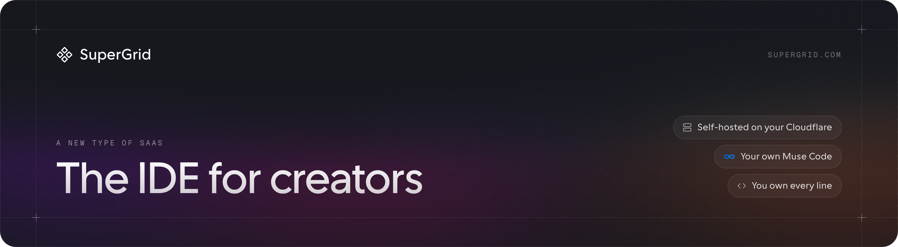
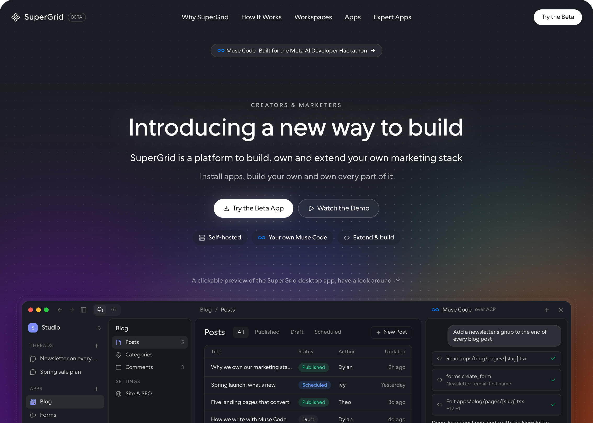
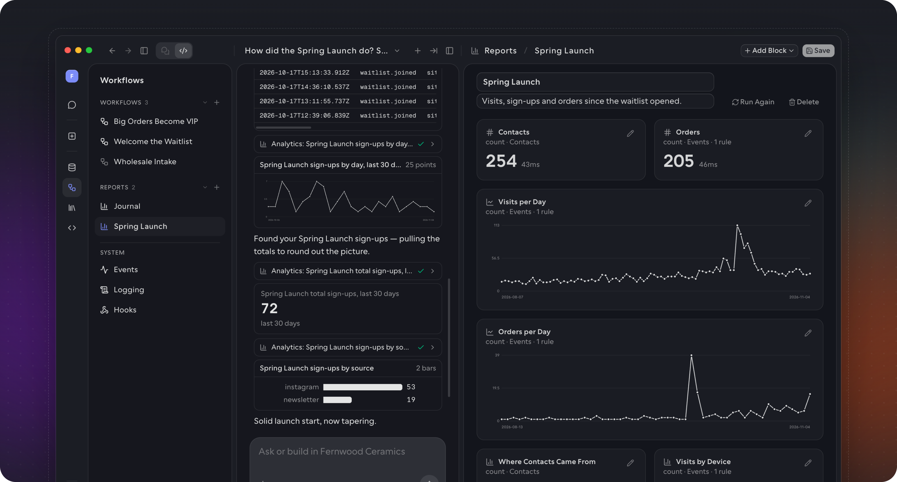
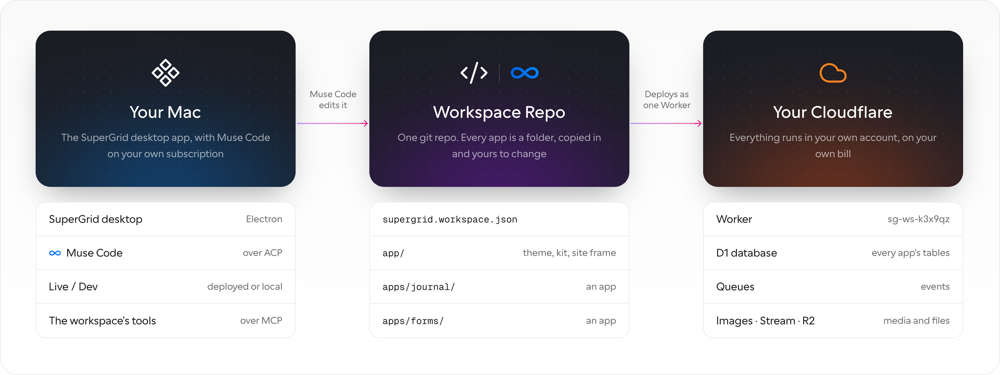
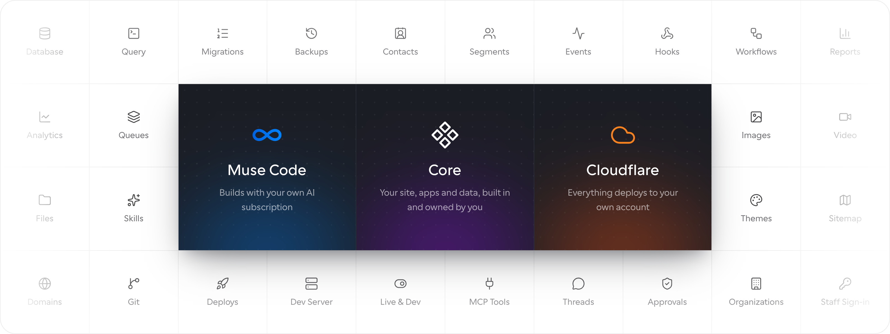

<p align="center">
  <a href="https://cerebralvalley.ai/e/meta-ai-developer-hackathon"></a>
</p>

<p align="center">
  <a href="https://supergrid.com"><b>supergrid.com</b></a> &nbsp;·&nbsp; <a href="https://supergrid.com/#demo">▶ Watch the demo</a>
</p>

## Why I built SuperGrid

I've been building SaaS products for over 20 years. Some worked, a lot more failed, and usually they failed on reach:
marketing, getting people to know the product exists. I launched two products in the last year and a half, and now people
are finding them, but some of them are getting their agents to "clone" their own. That makes building a SaaS business
harder. It also means they clone what they can see, without the time, the choices and the years of experience behind why
I built it "that way".

You can see it all over social media, YouTube and Twitter: people "vibe cloning" their own versions, giving them away
for free, or even trying to resell them. Builders are losing customers, and they're getting suspicious of the customers who
like their product, wondering if they're just getting an agent to recreate it.

Cloning an app is a lose-lose: I lose revenue, and they get a worse copy. So instead of fighting this new behaviour, I'm
building SuperGrid to make what people are already doing easier.

My work is helping creators market themselves and sell their products, and I want my products to actually help people.
About 80% of a SaaS product is the same for every product: database, auth, events, analytics and so on.

SuperGrid is the base of this new kind of SaaS. It ships with everything an app needs (database, events, analytics,
assets, hosting), so I can ship the core of a product, the 20%, and it plugs into the customer's own workspace and
business. They aren't cloning it. They get the code, and they can extend it and make it their own.

I think people are cloning apps, and searching for "open source" clones, because they want to own their software and
self-host it. They want to use their own AI subscription, like Muse Code. They don't like token resellers charging a
premium for what they already pay for. And they don't want to pay for 100 features to only use 3.

## What I built this week

I spent the last week building and prototyping how this could work. There are a lot of moving parts, and I explored
everything from a hosted version to a registry to microfrontends. I settled on this: a workspace is a monorepo, apps are
copied into it (shadcn style), and updates arrive as a merge that Muse Code resolves when it conflicts with your changes.

Because most of the time went into prototyping how this model could work, the demo isn't as polished as I'd like. The
desktop app and the infrastructure behind it are there, but I didn't have time to build real apps to install, or the app
store.

The desktop app is the "IDE" for the user. They connect their own Muse Code (over ACP, the Agent Client Protocol) and
create apps on the core system, which handles the shared parts for them. Everything is then bundled and deployed to their
own Cloudflare account.

## My goal

Port all my own apps and open an app store, where people pay to copy an app into their own repo. Build the core apps that
let people self-host their own ClickFunnels, and let other builders make apps and list them for sale.

This wouldn't have been possible a few years ago. Tools like Muse Code make it possible: every user gets a CTO who helps
with updates and code, and that's what lets this new kind of SaaS be explored.

I believe more of these kinds of "IDEs" and "harnesses" may become popular for different industries. Mine is for
creators and marketers, but I can see ones built for productivity, small business and more: operated by agents, with a
core that's opinionated and owned, and every app installing into that core. The apps are the highly specialized,
thoughtful solutions, built by the people who can solve each problem best.

— Dylan



## Try it

### Download

**[SuperGrid for macOS (Apple Silicon)](https://github.com/supergrid-com/supergrid-app/releases/latest)**

The build isn't signed yet, so macOS blocks the first open. Right-click SuperGrid in Applications and choose **Open**, or
clear the quarantine flag:

```bash
xattr -dr com.apple.quarantine /Applications/SuperGrid.app
```

### Or run it from source

Anyone can run the desktop app in dev mode straight from this repo, on an Apple Silicon or Intel Mac. You need Node, pnpm
and git:

```bash
git clone https://github.com/supergrid-com/supergrid-app.git
cd supergrid-app
pnpm -C core install
pnpm -C app install
pnpm -C app dev
```

`pnpm -C app dev` opens SuperGrid with hot reload, so you can change the app while you use it. `pnpm -C app dist` builds
the `.dmg`.



### What you need

| For | You need |
|---|---|
| The chat | Muse Code installed and signed in with `muse login`. SuperGrid uses your login and holds no model account. |
| Any workspace, including the demo | Node, pnpm and git |
| Deploying to Cloudflare | A Cloudflare account and the `cf` CLI (`npm i -g cf`). Wrangler ships inside the app. |

### Explore the demo without a Cloudflare account

On first launch, choose **Explore a Demo**. SuperGrid makes a workspace that lives only on your Mac, for a made-up
ceramics store called Fernwood Ceramics: about 250 contacts, 8,600 events over 90 days, segments, three workflows, and a
Journal app with posts. It's a real workspace running on its local dev server and database, filled with sample data, so
you can ask Muse Code about it or have it change the code. The first run installs packages, so it needs the network.
**Reset Demo Data** in the workspace's settings puts it back.

## How it fits together



```
Organization        one Cloudflare account, with its members
  └─ Workspace      sg-ws-<id>: one git repo, one Worker, one D1 database, its own domain
       └─ App       apps/<id>/: a folder in that repo, copied in and yours to change
```

A workspace is one repo and one Worker. Every app is a folder under `apps/`, and the build puts them all into the one
Worker, so apps share a database, sign-in, theme and events through plain imports. Each app has public pages under its
mount (`/shop`), admin screens under `/admin/<app>` and an API under `/api/<app>`.

Everything runs in the customer's own account. The Cloudflare bill is theirs, and nothing in the account depends on us to
keep serving traffic.

## What every workspace ships with

This is the shared core every app is built on.



| | |
|---|---|
| **Database** | One D1 database. Apps add their own tables, prefixed `app_<id>_`, through migrations the workspace tracks. |
| **Contacts** | People, custom fields, tags and segments, shared by every app. |
| **Events and analytics** | Page views, sign-ups, orders and app events, recorded through Cloudflare Queues and rolled up daily. |
| **Workflows and hooks** | Steps that run when an event happens: wait, branch, tag a contact, send. |
| **Assets** | Images, video and files over Cloudflare Images, Stream and R2. |
| **Themes** | Colors, fonts and logo as CSS variables at runtime, which the agent can change. |
| **Sitemap and domains** | Which app serves which path. |
| **Staff sign-in** | Admin screens open behind a signed handoff from the desktop app. |
| **Hosting** | Cloudflare Workers. Deploying is one upload, and one version to roll back. |

## The desktop app

The desktop app manages organizations, workspaces and apps, and gives you the coding agent.

| Area | What it is for |
|---|---|
| **Threads** | Conversations with Muse Code. Each one works in the workspace's repo and keeps its history. |
| **Apps** | The installed apps. An app opens its admin screens in the canvas. **+** makes a new app from the template. |
| **Database** | Every table and its rows, a SQL console and the migrations apps have applied. |
| **Workflows** | What runs when an event happens. |
| **Events** | Everything the workspace records, live. |
| **Library** | Images, media, files, themes and skills the apps share. |
| **Settings** | The workspace (domain, sitemap, updates), then the organization (workspaces, Cloudflare, appearance). |

**Live / Dev** in the title bar picks what you're looking at. Live is the deployed Worker. Dev runs the repo's dev server
on a local database and adds the **Code** section: files by app, git, the server log and deploys.

Muse Code gets tools for the workspace: read an app's operations and call them, query the database, find the files behind
a screen, make a new app, change the theme, and deploy. It also gets the docs in [core/docs](core/docs).

## Apps and updates

An app is a folder: a manifest (`supergrid.app.json`), React Router routes for its public, admin and API pages,
migrations, and operations that show up both as an API and as tools for the agent. [Building an
app](core/docs/build-an-app.md) walks through one.

Apps are copied in rather than installed as packages, the way shadcn/ui copies components in. Once an app is in your repo
it's your code. The update plan keeps that true:

- An app's upstream is its own git repo. Installing it adds the folder and records the version in a lock file.
- An update is a three-way merge of that one folder on a branch. A folder nobody touched just moves forward.
- When your changes conflict with the update, Muse Code resolves the conflicts, explains what changed and what it kept,
  and asks you to approve.
- Before the branch merges, checks run: new permissions need your consent, migrations may only be added, the build has to
  pass.

The full design is in [core/WORKSPACE-REPO.md](core/WORKSPACE-REPO.md).

## Where it stands

**Works today**

- The macOS desktop app, signing in to Cloudflare through the `cf` CLI with no token to paste
- Creating a workspace: its repo is scaffolded, built and deployed as one Worker with its D1 database
- Live / Dev, with the dev server, the Code section and deploys
- New apps from the template, with admin screens inside the desktop
- Database, Events, Workflows and Library pages on the workspace's real data
- Muse Code in the chat over ACP, with the workspace tools
- The local demo workspace

**Not finished yet**

- Installing and updating apps from someone else's repo. It's structured, and the update path is tested on a test account
  (signed releases, merging a new version into an app the owner changed), but it isn't polished or set up for real
  third-party updates yet
- The app store
- Example apps: Blog, Forms and Landing Pages
- Accounts for a workspace's own customers (staff sign-in only so far)
- Builds for Intel Macs, Windows and Linux

## In this repo

| Folder | What it is |
|---|---|
| [app/](app/README.md) | The desktop app (Electron). How it works: [DESKTOP.md](app/DESKTOP.md), [AGENT.md](app/AGENT.md), [DEMO.md](app/DEMO.md). |
| [core/](core/README.md) | What runs in the customer's account: the workspace Worker, the shared packages, the workspace and app templates, the `sg` CLI, the docs and the demo seed. |
| [dev/](dev/README.md) | A test workspace and smoke tests against a real account. Nothing here ships. |
| [launch/](launch/site/README.md) | The supergrid.com site and the launch film. |
| `branding/` | The tool the mark and palettes were made in. |
| `app-v1/` | The first desktop app, kept for reference. |

## Built with

Cloudflare Workers, D1, Queues, R2, Images and Stream · React Router · Electron · Muse Code over ACP · base-ui and coss/ui
